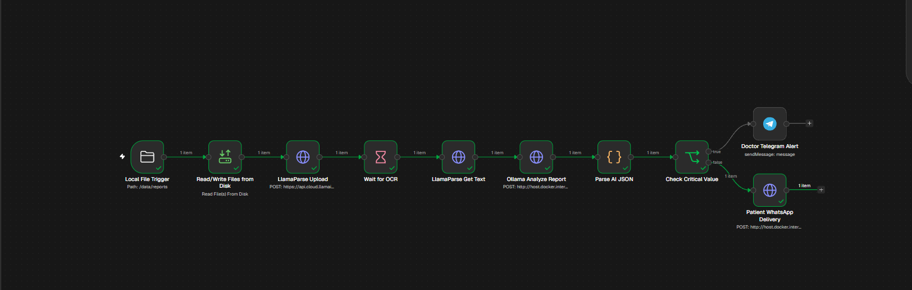
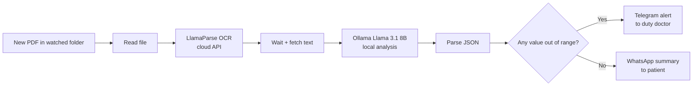

# Medical Report Router & Alert System

> Routes lab-report PDFs automatically: out-of-range results are flagged to a doctor on Telegram, and the rest get a plain-language summary sent to the patient on WhatsApp.

**Status: working prototype. Tested on synthetic data only. Not for real patient use.**

> ⚠️ **Disclaimer:** This is a proof of concept that assists clinic staff. It does not diagnose, give medical advice, or replace a doctor. All sample data in this repo is synthetic.

## Demo

[](https://youtu.be/78sOkOAcsbA)

▶️ [Watch the demo video on YouTube](https://youtu.be/78sOkOAcsbA)



## Problem

In small diagnostic centers, lab reports often arrive as PDFs and are checked by hand before reaching a doctor or patient. In a busy queue, abnormal values can be overlooked and patients wait longer for results.

## Who it's for

Small diagnostic centers and clinics that receive lab results as PDFs. [FILL: add a specific target user only if you have their permission, otherwise delete this line]

## Solution overview

A new report PDF dropped into a watched folder is read by OCR, analyzed by a local LLM, and routed to the right person.



## Tech stack (free-tier tools)

| Part | Tool |
|---|---|
| Automation | n8n (self-hosted, Docker Desktop / WSL) |
| OCR | LlamaParse API (free tier, cloud) |
| LLM | Ollama + Llama 3.1 8B (runs locally) |
| Doctor alerts | Telegram Bot API |
| Patient messages | WAHA (unofficial WhatsApp HTTP API, Docker, port 3001) |
| Glue code | JavaScript expressions in n8n |

## How it works

1. **Local File Trigger** watches a folder for new PDF reports.
2. **Read/Write Files from Disk** loads the PDF.
3. **LlamaParse Upload → Wait → Get Text** converts the PDF into structured Markdown text.
4. **Ollama Analyze Report** sends the text to Llama 3.1 8B (`/api/generate`). The prompt asks for JSON only: patient details, an `is_critical` flag, a list of `abnormal_tests`, and a short administrative summary.
5. **Parse AI JSON** reads the model output.
6. **Check Critical Value** (IF node) routes the report:
   - **true** → formatted Telegram alert to the duty doctor with the abnormal values
   - **false** → WhatsApp summary to the patient via WAHA

The prompt tells the model to judge by the numeric value against the reference range and to ignore subjective comments such as "mildly elevated". This is designed to reduce missed abnormal values. It does not guarantee none are missed.

## Human-in-the-loop / safety design

- Flagged reports go to a doctor, who makes the decision.
- **Current gap:** reports that are not flagged go to the patient with no staff review. A production version must add a staff approval step before any patient message.
- Only synthetic reports are used. No real patient data is stored in this repo.

## Results

| Metric | Result | How measured | Data type |
|---|---|---|---|
| End-to-end run (PDF → message) | Completed on 2 sample reports in `data/sample/` | Manual test, screen recording (see demo) | Synthetic |
| Branches exercised | [FILL: Telegram / WhatsApp / both] | Screen recording | Synthetic |
| Time per report | Not measured yet | n/a | n/a |
| Accuracy / missed abnormal values | Not measured yet | Planned: 30–50 labeled synthetic reports | n/a |
| Valid-JSON rate of the LLM output | Not measured yet | Planned | n/a |

## Limitations & risks

- **Not fully local:** the PDF is sent to the LlamaParse cloud API for OCR. Only the LLM analysis runs on your machine.
- **"Flagged" is not "clinically critical".** Any value outside its reference range triggers the doctor alert, so it can over-alert. A better design uses two levels: abnormal and critical.
- **The LLM makes the decision.** A safer design lets the LLM only extract values, and a code node compares them with the ranges.
- An 8B model can make mistakes and has not been formally evaluated.
- **WAHA is unofficial.** The WhatsApp number can be banned, so use test numbers only. A real deployment should use the official WhatsApp Business API.
- No staff approval before patient messages (see above).

## Setup

1. Install [Docker Desktop](https://www.docker.com/products/docker-desktop/) and run n8n.
2. Install [Ollama](https://ollama.com) and pull the model:
   ```bash
   ollama pull llama3.1:8b
   ```
3. Run a WAHA container (port 3001) and link a **test** WhatsApp number via QR code.
4. Create a Telegram bot with @BotFather and note the bot token and your chat ID.
5. Get a free LlamaParse API key from LlamaCloud.
6. Copy `.env.example` to `.env` and fill in your own values. Never commit `.env`.
7. In n8n, import `medical-report-router/workflows/medical-report-router.json`, then add your own credentials in the HTTP and Telegram nodes.
8. Mount your reports folder into the n8n container (the workflow watches `/data/reports`) and drop a PDF from `medical-report-router/data/sample/` into it.

## Lessons learned

- Docker containers reach host services (Ollama, WAHA) through `host.docker.internal`, and each service needs its own port (n8n 5678, WAHA 3001).
- Forcing JSON-only output through prompt design is possible, but needs measuring before claiming reliability.
- Local phone numbers (017…) must be converted to the WhatsApp format (88017…@c.us). A JavaScript expression in n8n does this.

## What I'd do next

1. Move the range comparison into a Code node so plain code decides.
2. Split into "abnormal" and "critical" levels.
3. Add staff approval before any patient message.
4. Evaluate on 30–50 labeled synthetic reports and publish accuracy and recall.
5. Use Ollama's JSON output option and measure the valid-JSON rate.

## License & contact

License: not added yet.
Built by [fhm16](https://github.com/fhm16). [FILL: email or LinkedIn, optional]
